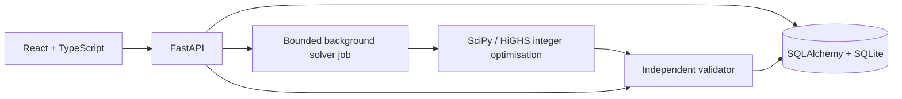

# Smart Roster Management System

**Live demo:** https://yjoy1572--datastraw-roster.us-east.modal.run

A monthly roster planner for the Datastraw AI + Tech internship assessment. It models client demand separately from employee availability, generates schedules through integer optimisation, and independently validates coverage, overlap, capacity and weekly rest.

The fictional sample contains **32 employees, 4 pods, 25 brands and 4 processes**. Twenty brands have one primary owner; five have multiple primary owners. Approved backup eligibility is configured separately.

## Run locally

Prerequisites: uv, Python 3.12 or 3.13, and Node.js 22.12 or newer.

```powershell
uv sync --locked
cd frontend
npm ci --legacy-peer-deps
npm run build
cd ..
uv run --locked python -m uvicorn backend.app.main:app --host 127.0.0.1 --port 8000
```

Open http://127.0.0.1:8000. FastAPI serves both the built interface and API. Each browser cookie receives an isolated workspace with fictional data; no account or API key is required. Saved data lives in `data/roster.db`.

For development, keep the API running and run `npm run dev` inside `frontend` in a second terminal. Vite proxies API requests to port 8000.

`.env.example` lists runtime variables. Set them in your shell or hosting environment; the app does not automatically load a `.env` file. Use `COOKIE_SECURE=true` on public HTTPS hosting.

## Demonstrate the scheduling problem

1. Generate **November 2026**. Company, Pod, Brand, Process and Employee views project the same roster.
2. Inspect Aurora Home: CS works every day, while NDR closes on Sundays and holidays. Field Notes closes on holidays; Olive Studio closes on Sundays and holidays. The fictional holiday is November 12.
3. Open a coverage cell to see employees, occupied AM/PM blocks, minimum staffing, and approved resource options. Orbit Goods CS requires two distinct people.
4. Approve **Asha Mehta's leave on November 15**. The current roster is marked stale and the affected coverage is rechecked. Repair creates a new draft, explains changes and preserves the original version. Review and publish the valid replacement.
5. Approve **Isha Verma's leave on November 16**. Her brand has no approved backup. Repair reports unresolved shortages and blocks publication.
6. Edit a draft employee/day cell, lock a duty and preview its impact before saving. Independent overlapping duties cannot be saved. Coverage excludes employees involved in overlap, capacity or rest conflicts from verified staffing.
7. Configure employees, pods, processes, allocations, client calendars, staffing overrides, absences and holidays in Team & rules. New-brand setup guides coverage, employee eligibility and permitted duties.
8. Export CSV, review version history, or inspect workload and backup-allocation risks. Published versions retain their original configuration; Check current rules assesses them against today's inputs.

## Architecture



The modular monolith serves UI and API from one origin. One solver job runs at a time, with a bounded queue and persisted job lifecycle. Generation uses an input snapshot; configuration revisions protect edits and publication. Interrupted jobs are marked on restart. Published versions are immutable, with one active published version per month.

Configuration uses workspace-scoped relational tables and typed record payloads. Roster versions snapshot configuration, assignments and prior work history. Changed preceding-month work marks dependent versions stale.

HiGHS is the tested default. The optional CP-SAT implementation requires installing OR-Tools and explicitly setting `ROSTER_SOLVER=cp-sat`; that optional engine has not been validated in this project. An LLM is not required to generate or validate schedules.

See the [approach note](docs/approach.md) for the design decisions.

## Assumptions and limits

- One timezone: Asia/Kolkata. Dates are local; audit timestamps are UTC.
- AM and PM are four-hour blocks. Full-day duties occupy both. Overnight shifts and partial-day absences are outside this version.
- Default maximum: eight work hours per day and at least one full non-working day in every rolling seven days. These are configurable assessment assumptions.
- Approved leave, comp-off, fixed offs, employment dates, approved dated eligibility and employee holiday exemptions are mandatory. Preferred off weekdays are soft preferences.
- A declared shared duty may cover multiple low-volume processes for one brand. Separate duties cannot overlap. Minimum staffing counts distinct people.
- Date/block demand overrides take precedence over process calendars, then brand calendars. A client holiday closure and an employee's availability are separate rules.
- November has seeded prior history. Other starting months can use Previous six days to confirm work/non-work history; a preceding published roster takes precedence when present.
- Six future days provide tentative planning context. After strict infeasibility, diagnostic priorities are current-month coverage, future coverage, assignment stability and preferences. Leave, eligibility, overlap, capacity, rest and locks stay mandatory.
- FEASIBLE, OPTIMAL, INFEASIBLE and UNKNOWN have different meanings. A timeout does not prove impossibility. Any current-month shortage blocks publication.
- Workload summaries support fairness review; equal-workload optimisation is not implemented. Comp-off accrual/payroll, notifications, multi-role approvals and LLM explanations are outside this version.
- The app uses a synthetic demo identity. Production authentication, quotas, workspace expiry, schema migrations and multi-instance job coordination are follow-ups.

## Verification

```powershell
uv run --locked python -m pytest -q
cd frontend
npm run build
cd ..
uv run --locked python scripts/smoke_test.py http://127.0.0.1:8000
uv run --locked python -m scripts.benchmark
```

The backend suite has 26 tests covering generation/repair, infeasibility, calendars, boundaries, conflicts, distinct coverage, locks, revisions, publication and workspace isolation. The doubled 64-employee/50-brand fixture has also been checked locally; local timing is not a hosted performance guarantee.

Browser checks are kept in `tests/browser`. Playwright is an optional test dependency:

```powershell
uv run --locked --with playwright python -m playwright install chromium
uv run --locked --with playwright python tests/browser/test_workflow.py http://127.0.0.1:8000
uv run --locked --with playwright python tests/browser/test_enhancements.py http://127.0.0.1:8000
uv run --locked --with playwright python tests/browser/test_coverage_regressions.py http://127.0.0.1:8000
uv run --locked --with playwright python tests/browser/test_sidebar.py http://127.0.0.1:8000
```

The workflow, focused coverage regressions, preserved snapshots, history setup and responsive layouts have passed Chromium checks. Generated screenshots and reports are excluded from version control.

## Dependencies and deployment

`pyproject.toml` and `uv.lock` are the dependency source of truth. The container uses an export of the same pinned versions:

```powershell
uv export --locked --no-hashes --no-emit-project --output-file requirements.lock
```

```powershell
docker compose up --build
```

Compose serves port 8000 and retains data in a named volume. Its insecure cookie setting is for local HTTP. Public hosting requires HTTPS, secure cookies, persistent storage and one application instance. The Linux container build and live scheduling workflow have been verified.

For Modal, use the [Modal deployment guide](docs/modal-deployment.md). `modal_app.py` deploys a separate single-container app with consistent SQLite snapshots on a dedicated persistent volume. Modal's CLI is isolated in the optional `deploy` dependency group.

## Tell us how you think

1. **Relationships:** Employees belong to pods with leads. Brand-process records define demand. Date-effective primary/backup allocations define employee eligibility. Duty templates define allowed process combinations and occupied blocks.
2. **Generation and correctness:** Expand calendars and eligibility, build assignment candidates, solve hard constraints, then independently recompute coverage and employee rules. Revalidate every edit and publication.
3. **Single versus multiple resources:** The demand model is shared; the approved candidate pool differs. Primary ownership and backup eligibility remain separate, including split and overlapping process responsibilities.
4. **Single owner unavailable:** Report the affected process gaps. Use an already approved backup only when the full roster remains valid; otherwise retain an invalid draft and require a staffing decision.
5. **Conflicting requirements:** Keep employee protections mandatory. After proven infeasibility, minimise current shortages before tentative future shortages and expose the exact gaps. UNKNOWN is reported separately.
6. **Automation versus control:** Automate generation, impact checks and repair proposals. Managers approve eligibility/time off, review changed assignments and publish. Repair creates a reviewable new version.
7. **Doubling the team:** Measure candidate count and solver time, prune candidate generation and index reporting queries. Move to PostgreSQL/shared workers when concurrency requires it. Shared employees prevent safely solving every pod independently.
8. **One extra week:** Improve workload calibration and operational policies, then production identity, migration/lifecycle management and richer shift/absence handling based on feedback.

AI coding tools assisted implementation and testing. Correctness evidence comes from deterministic validation, regression tests and executed solver/browser workflows.
